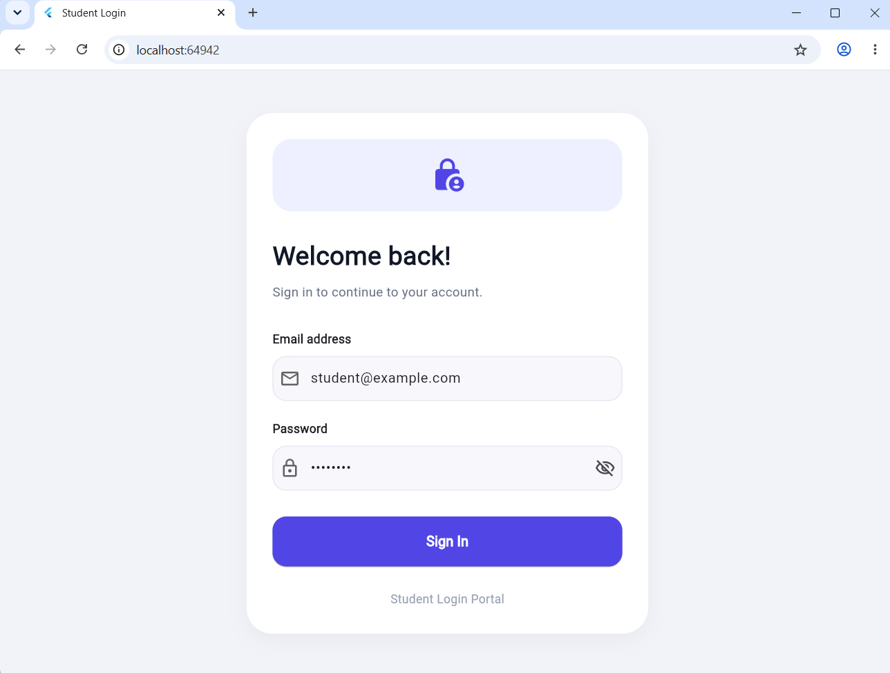
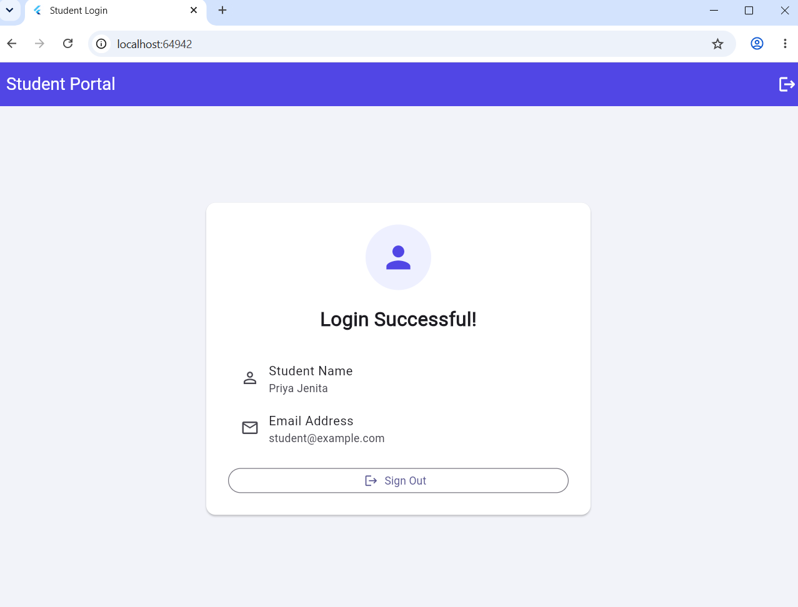

# Experiment 10: Manual User Login Authentication using Google Firestore Database

## Aim
To develop a Flutter application that provides a secure and user-friendly login interface using Firebase Authentication and Google Cloud Firestore to retrieve user profile information.

## Description
This experiment demonstrates how to integrate a Flutter application with Firebase Authentication and Cloud Firestore. Users enter their email address and password on the login screen. Firebase Authentication verifies the credentials, and Firestore retrieves the user's profile information.

If authentication succeeds, the application displays a welcome screen containing the user's name and email address. If the credentials are invalid or a database error occurs, an appropriate error message is displayed. The application also includes input validation, a password visibility control, loading feedback, and a Sign Out option.

**Note:** Passwords are verified by Firebase Authentication and must not be stored as plain text in Firestore.

## Technologies Used
- Flutter
- Dart
- Firebase Core
- Firebase Authentication
- Cloud Firestore
- Visual Studio Code
- Google Chrome

## Firebase Configuration
- Firebase Project ID: `flutter-7-ff746`
- Authentication Method: Email/Password
- Firestore Collection: `users`
- Document ID: Firebase Authentication user's UID

## Firestore Database Structure

### Collection: `users`

| Field | Data Type | Description |
|---|---|---|
| `name` | String | Name of the user |
| `email` | String | Registered email address |
| `createdAt` | Timestamp | Profile creation time, if present |

Each user's profile document is stored using their Firebase Authentication UID as the document ID. This allows the application to retrieve the profile belonging to the authenticated user.

## Application Features
1. Professional login interface.
2. Email address validation.
3. Password input with show/hide functionality.
4. Firebase Authentication using email and password.
5. User profile retrieval from Cloud Firestore.
6. Automatic creation of a basic profile if one does not exist and Firestore rules permit it.
7. Error messages for invalid credentials and database access failures.
8. Loading indicator during authentication.
9. Welcome screen displaying the user's name and email.
10. Sign Out functionality.

## Project Structure

```text
flutter_application_10/
├── lib/
│   ├── main.dart
│   └── firebase_options.dart
├── screenshots/
│   ├── initial_screen.png
│   ├── invalid_login.png
│   ├── successful_login.png
│   ├── student_profile.png
│   └── sign_out.png
├── pubspec.yaml
├── pubspec.lock
└── README.md
```

## Packages Used

Add the required packages using:

```bash
flutter pub add firebase_core firebase_auth cloud_firestore
```

## Steps to Execute
1. Install Flutter and configure the Flutter development environment.
2. Open the project in Visual Studio Code.
3. Configure the application with the Firebase project.
4. Enable Email/Password authentication in Firebase Console.
5. Create the `users` collection in Cloud Firestore as required.
6. Add the required Firebase configuration file.
7. Run the following commands in the project terminal:

```bash
flutter pub get
flutter run -d chrome
```

8. Enter the email address and password of an account registered in Firebase Authentication.
9. Verify that successful login opens the student portal.
10. Test invalid credentials and the Sign Out button.

## Expected Output

### 1. Initial Screen
The application displays a login page containing email and password fields and a Sign In button.

### 2. Successful Login
When valid credentials are entered, Firebase Authentication verifies the user and the application displays a welcome screen with the user's name and email.

### 3. Invalid Login
When incorrect credentials are entered, an appropriate error message is displayed.

### 4. Profile Retrieval
The application retrieves the user's profile from the `users` collection using the authenticated user's UID.

### 5. Sign Out
The user can sign out and return to the login screen.

## Screenshots

Add your screenshots to the `screenshots` folder and update the filenames below if necessary.

### Initial Login Screen


### Successful Login


## Result
The Flutter login application was developed and tested successfully. Firebase Authentication verifies the user's credentials, while Cloud Firestore stores and retrieves the user's profile information. The application demonstrates input validation, authentication error handling, profile retrieval, conditional navigation, and sign-out functionality.
